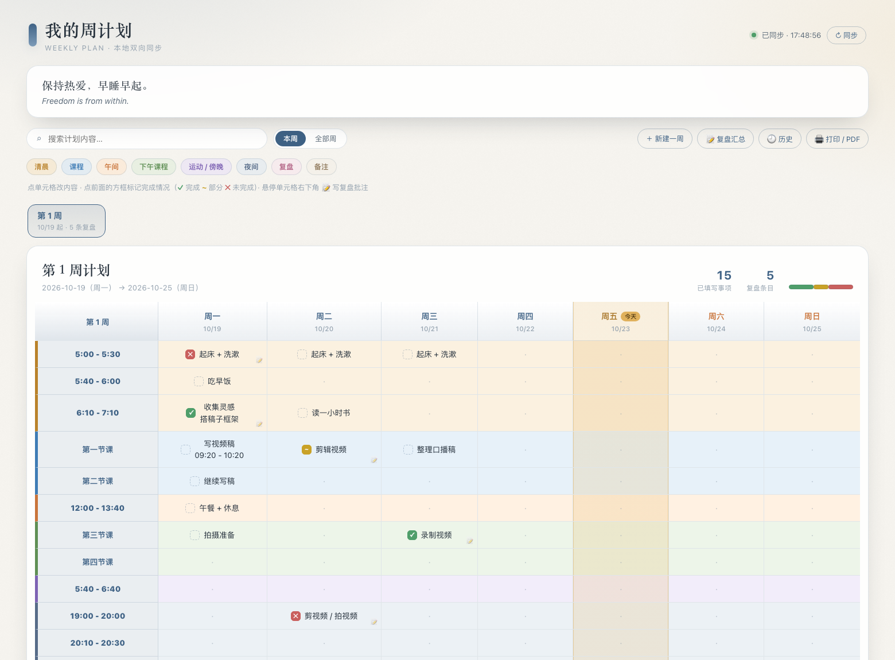

# Weekloop

**私人日程管理助手** — 规划 → 提醒 → 复盘，每周转一圈。

把聊天记录、截图或一段对话，整理成 **Obsidian 周计划表**、**Apple 日历事件**与**提醒事项**，
并支持用对话的方式做复盘，把结果写回计划表。

> 名字来自它的工作方式：不是「记完就完」的待办清单，而是每周循环一次 ——
> 排好计划、到点提醒、回来问你做到了没、把原因写回表里、调整下周。



> 上图是配套的本地网页看板：点方框打勾、点右下角写复盘批注、跨周搜索、导出 PDF。
> 它和 Skill 读写同一份 Obsidian 笔记，可以混着用。

## 三条输出通道

| 通道 | 适合放什么 |
| --- | --- |
| **Obsidian 周计划表** | 固定时段的日常安排、作息、课程、周计划、复盘批注 |
| **Apple 日历** | 有明确时间点的约见、会议、活动 |
| **Apple 提醒事项** | 有动作但没有固定时间点的待办 |

三条可以组合，也可以只用其中一条。

## 功能

- **规划**：从聊天记录 / 截图 / 对话里提取安排，写成周计划表
- **导入日历与提醒**：有时间的进日历，要做的进提醒事项，相关图片作为原生附件
- **对话式复盘**：陪你一条条过这周的执行情况，把原因记进计划表
- **勾选状态**：`完成` / `部分` / `未完成`，一眼看出哪里崩了
- **幂等**：同一事项复用稳定 key，更新原对象而不是重复创建
- **可撤销**：写 Obsidian 前自动备份；Apple 端保留原生 ID 映射
- **每日提醒**：每天 09:00 / 21:00 各一个规划提醒（可选）

## 安装

```bash
mkdir -p ~/.codex/skills
cp -R 私人日程管理助手 ~/.codex/skills/
```

安装后目录应为：

```text
~/.codex/skills/私人日程管理助手/
```

在 Codex 中调用：

```text
$私人日程管理助手 把这周的安排排成 Obsidian 周计划表。
```

```text
$私人日程管理助手 分析这份聊天记录，固定时间的写进日历，要做的写进提醒事项，图片作为附件。
```

```text
$私人日程管理助手 我想复盘这周，陪我一条条过一下。
```

## 快速开始

```bash
S=~/.codex/skills/私人日程管理助手/scripts

# 1) 初始化 Obsidian 目录、模板与样式
python3 "$S/obsidian_plan.py" init-vault --vault "/path/to/YourVault"

# 2) 建一周
python3 "$S/obsidian_plan.py" new-week --vault "/path/to/YourVault" \
  --week 1 --start 2026-10-19

# 3) 填内容
python3 "$S/obsidian_plan.py" set-cell --vault "/path/to/YourVault" \
  --week 1 --row "5:00 - 5:30" --day 周一 --value "起床 + 洗漱"

# 4) 复盘
python3 "$S/obsidian_plan.py" set-review --vault "/path/to/YourVault" \
  --week 1 --row "5:00 - 5:30" --day 周一 \
  --status 未完成 --note "昨晚刷手机到 1 点，赖床到 5:40"
```

## 权限（Apple 部分）

在「系统设置 > 隐私与安全性」里给 Codex / 终端授权：

1. 日历
2. 提醒事项
3. 辅助功能（添加图片附件需要）

WorkBuddy 等缺少 Apple Events 权限的宿主，用独立 Helper：

```bash
python3 ~/.codex/skills/私人日程管理助手/scripts/install_helper.py
python3 ~/.codex/skills/私人日程管理助手/scripts/check_permissions.py
```

Helper 当前仍保留旧名称 `Apple Chat Scheduler Helper.app` 和旧 bundle id，以保持已经授予的 macOS TCC 权限稳定。

## 目录结构

```text
SKILL.md                              工作流与规则
INTRO.md                              介绍
agents/openai.yaml                    Skill 显示信息
references/install-and-usage.md       安装、权限、脚本逐条用法
references/obsidian-workflow.md       Obsidian 数据契约与排错
references/review-workflow.md         对话式复盘流程
scripts/obsidian_plan.py              Obsidian 周计划读写
scripts/apple_scheduler.py            Apple 日历/提醒事项读写
scripts/extract_chat_archive.py       解压聊天记录
scripts/install_helper.py             安装独立 Helper
scripts/check_permissions.py          权限自检
```

## 与网页端的关系

配套的本地网页（weekly-plan-viewer）与 Mouse 本 Skill **读写同一份 Obsidian 笔记**，
格式契约见 `references/obsidian-workflow.md`。两边可以混用：
在网页上打勾、在 Obsidian 里写字、用 Skill 做复盘，都是同一份数据。
